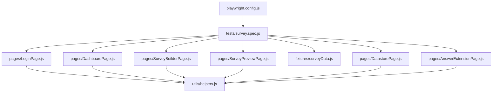
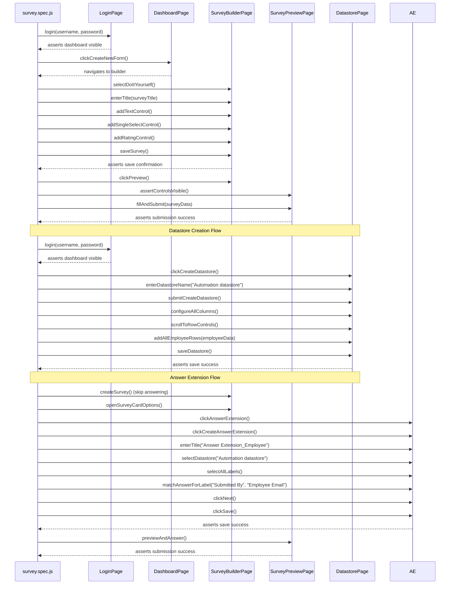

# Design Document

## Feature: survey-module-automation

---

## Overview

This document describes the technical design for a Playwright + JavaScript end-to-end automation framework that automates the complete survey creation and submission workflow on `https://stg-genforms.mobilityeye.com/`.

The framework follows the **Page Object Model (POM)** pattern: all page-specific locators and interaction logic are encapsulated within dedicated page classes, keeping test scripts lean and readable. The design prioritizes maintainability, deterministic synchronization (no hardcoded waits), and clear separation of concerns across pages, fixtures, utilities, and configuration.

The automation covers the full happy-path workflow:
1. Authenticate via the login page
2. Navigate to survey creation
3. Enter a survey title
4. Add three controls: Text, Single Select, Rating
5. Save the survey
6. Preview and assert controls are rendered
7. Fill in the survey and submit
8. Assert successful submission
9. Create a new datastore named "Automation datastore"
10. Configure five columns (Employee Name, Employee Email, Employee phone number, Language, Channel)
11. Populate four employee records
12. Save the datastore and verify success
13. Create the survey (skip answering)
14. Open survey card options → Answer Extension
15. Create Answer Extension linked to the datastore
16. Configure label matching (Submitted By → Employee Email)
17. Save the Answer Extension
18. Preview and answer the survey with Answer Extension applied

---

## Architecture

### High-Level Component Flow



### Execution Flow



### Design Decisions

| Decision | Choice | Rationale |
|---|---|---|
| Test runner | Playwright Test (`@playwright/test`) | Built-in, no extra dependencies; supports fixtures, parallel runs, and HTML reports natively |
| Browser | Chromium | Specified in requirements; fastest for CI pipelines |
| Sync strategy | Playwright auto-waiting + `expect` assertions | Eliminates flaky waits; Playwright waits for actionability automatically |
| Credentials storage | `.env` file + `dotenv` package | Keeps secrets out of source code; standard Node.js practice |
| POM structure | One class per page | Clear ownership of locators; changes to the app only require updating the relevant page class |
| Test data | Central fixtures file | Single source of truth for all test values; easy to update |

---

## Components and Interfaces

### `playwright.config.js`

The central configuration file loaded automatically by Playwright Test.

**Key settings:**
- `baseURL`: read from `process.env.BASE_URL` (default: `https://stg-genforms.mobilityeye.com/`)
- `headless`: controlled by `process.env.HEADLESS !== 'false'` (headless by default)
- `browser`: `chromium`
- `reporter`: `html` (generates `playwright-report/` after each run)
- `use.screenshot`: `only-on-failure` (captures screenshots on failure for debugging)
- `use.video`: `retain-on-failure`

```js
// playwright.config.js (outline)
import { defineConfig, devices } from '@playwright/test';
import dotenv from 'dotenv';
dotenv.config();

export default defineConfig({
  testDir: './tests',
  reporter: 'html',
  use: {
    baseURL: process.env.BASE_URL || 'https://stg-genforms.mobilityeye.com/',
    headless: process.env.HEADLESS !== 'false',
    screenshot: 'only-on-failure',
    video: 'retain-on-failure',
  },
  projects: [
    {
      name: 'chromium',
      use: { ...devices['Desktop Chrome'] },
    },
  ],
});
```

---

### `fixtures/surveyData.js`

Exports all test data constants used across the test suite.

```js
// fixtures/surveyData.js
export const surveyData = {
  title: 'Automation Survey',
  textResponse: 'Playwright Automation Test',
  singleSelectStrategy: 'first available option',
  ratingStrategy: 'maximum available rating',
};

export const datastoreData = {
  name: 'Automation datastore',
  columns: ['Employee Name', 'Employee Email', 'Employee phone number', 'Language', 'Channel'],
  employees: [
    { name: 'Suhaila', email: 'Suhaila@mobilityeye.com', phone: '0565106373', language: 'En', channel: 'Email' },
    { name: 'Sneha', email: 'Sneha@mobilityeye.com', phone: '0565106373', language: 'En', channel: 'Email' },
    { name: 'Anjana', email: 'Anjana@mobilityeye.com', phone: '0565106373', language: 'En', channel: 'Email' },
    { name: 'Sri', email: 'sri@mobilityeye.com', phone: '0565106373', language: 'En', channel: 'Email' },
  ],
};

export const answerExtensionData = {
  title: 'Answer Extension_Employee',
  datastoreName: 'Automation datastore',
  matchAnswer: 'Submitted By',
  matchLabel: 'Employee Email',
};
```

---

### `utils/helpers.js`

Reusable utility functions shared across page objects. Helpers operate on the Playwright `page` object and provide wrappers for common patterns.

**Interface:**

```js
// utils/helpers.js

/**
 * Waits for a locator to be visible then clicks it.
 * Uses Playwright auto-waiting — no manual timeout.
 */
export async function clickWhenReady(locator) { ... }

/**
 * Fills a text field after waiting for it to be editable.
 */
export async function fillWhenReady(locator, value) { ... }

/**
 * Asserts a locator is visible with a descriptive error message.
 */
export async function assertVisible(locator, description) { ... }
```

---

### `pages/LoginPage.js`

Handles all authentication interactions.

**Constructor:** accepts a Playwright `page` object.

**Locators (private):**
- `usernameInput`: the username field
- `passwordInput`: the password field
- `submitButton`: the login/submit button

**Methods:**

| Method | Parameters | Description |
|---|---|---|
| `navigate()` | — | Navigates to `baseURL` |
| `login(username, password)` | `string, string` | Fills credentials and clicks submit |

```js
// pages/LoginPage.js (outline)
export class LoginPage {
  constructor(page) {
    this.page = page;
    this.usernameInput = page.locator('[name="username"], input[type="email"]');
    this.passwordInput = page.locator('[name="password"], input[type="password"]');
    this.submitButton  = page.locator('button[type="submit"]');
  }

  async navigate() {
    await this.page.goto('/');
  }

  async login(username, password) {
    await this.usernameInput.fill(username);
    await this.passwordInput.fill(password);
    await this.submitButton.click();
  }
}
```

> **Note:** Exact locators will be confirmed during implementation by inspecting the live application. The locator strategies shown are representative.

---

### `pages/DashboardPage.js`

Handles post-login dashboard interactions.

**Locators (private):**
- `dashboardIndicator`: an element that confirms successful login (e.g., a nav header or welcome message)
- `createNewFormButton`: the "Create a new form" button/link

**Methods:**

| Method | Parameters | Description |
|---|---|---|
| `assertDashboardVisible()` | — | Asserts `dashboardIndicator` is visible |
| `clickCreateNewForm()` | — | Clicks the "Create a new form" element |

---

### `pages/SurveyBuilderPage.js`

Handles survey construction: title entry, adding controls, saving, and navigating to preview.

**Locators (private):**
- `doItYourselfOption`: the "Do it yourself" option displayed after clicking "Create a new form"
- `builderCanvas`: the survey builder interface root element
- `titleInput`: the survey title input field
- `textControlButton`: the button/element to add a Text control
- `singleSelectControlButton`: the button/element to add a Single Select control
- `ratingControlButton`: the button/element to add a Rating control
- `textControlInCanvas`: confirmation that a Text control is present in the canvas
- `singleSelectControlInCanvas`: confirmation that a Single Select control is present in the canvas
- `ratingControlInCanvas`: confirmation that a Rating control is present in the canvas
- `saveButton`: the Save button
- `saveConfirmation`: the success message or confirmation indicator after saving
- `previewButton`: the Preview button

**Methods:**

| Method | Parameters | Description |
|---|---|---|
| `selectDoItYourself()` | — | Clicks the "Do it yourself" option |
| `assertBuilderVisible()` | — | Asserts the builder canvas is visible |
| `enterTitle(title)` | `string` | Fills the title input and asserts the value |
| `addTextControl()` | — | Adds a Text control and asserts its presence in the canvas |
| `addSingleSelectControl()` | — | Adds a Single Select control and asserts its presence |
| `addRatingControl()` | — | Adds a Rating control and asserts its presence |
| `saveSurvey()` | — | Clicks Save and asserts the save confirmation is visible |
| `clickPreview()` | — | Clicks the Preview button |

**Control addition pattern** (same for all three controls):
1. Click the control's add button in the builder sidebar/toolbar
2. If the control requires mandatory configuration (e.g., adding options to Single Select), fill those fields with sample data
3. Assert the control appears in the canvas using an explicit `expect(locator).toBeVisible()` assertion

---

### `pages/SurveyPreviewPage.js`

Handles survey preview verification and submission.

**Locators (private):**
- `previewContainer`: the root element of the preview interface
- `textField`: the Text control input in the preview
- `singleSelectDropdown`: the Single Select control in the preview
- `singleSelectFirstOption`: the first available option in the Single Select
- `ratingControl`: the Rating control in the preview
- `ratingMaxOption`: the highest-value rating option
- `submitButton`: the Submit button
- `successMessage`: the post-submission success confirmation element

**Methods:**

| Method | Parameters | Description |
|---|---|---|
| `assertPreviewVisible()` | — | Asserts the preview container is visible |
| `assertAllControlsVisible()` | — | Asserts Text, Single Select, and Rating controls are visible |
| `fillTextControl(value)` | `string` | Fills the Text control with the provided value |
| `selectFirstSingleSelectOption()` | — | Opens the Single Select and clicks the first available option |
| `selectMaxRating()` | — | Clicks the highest available rating option |
| `submit()` | — | Clicks the Submit button |
| `assertSubmissionSuccess()` | — | Asserts the success message is visible |

---

### `pages/DatastorePage.js`

Handles datastore creation, column configuration, row population, and saving.

**Constructor:** accepts a Playwright `page` object.

**Locators (private):**
- `createDatastoreButton`: `page.getByTitle('Create Datastore ')`
- `datastoreNameInput`: `page.locator('//input[@class="mat-mdc-input-element ng-tns-c13-175 ltr mat-mdc-form-field-input-control mdc-text-field__input ng-pristine ng-invalid cdk-text-field-autofill-monitored ng-touched"]')`
- `column1Input`: `page.locator('//input[@class="mat-mdc-input-element ng-tns-c13-181 ltr mat-mdc-form-field-input-control mdc-text-field__input ng-pristine cdk-text-field-autofill-monitored ng-invalid ng-touched"]')`
- `column2Input`: `page.locator('//input[@class="mat-mdc-input-element ng-tns-c13-183 ltr mat-mdc-form-field-input-control mdc-text-field__input ng-pristine cdk-text-field-autofill-monitored ng-invalid ng-touched"]')`
- `column3Input`: `page.locator('//input[@class="mat-mdc-input-element ng-tns-c13-193 ltr mat-mdc-form-field-input-control mdc-text-field__input ng-pristine cdk-text-field-autofill-monitored ng-invalid ng-touched"]')`
- `column4Input`: `page.locator('//input[@class="mat-mdc-input-element ng-tns-c13-195 ltr mat-mdc-form-field-input-control mdc-text-field__input ng-pristine cdk-text-field-autofill-monitored ng-invalid ng-touched"]')`
- `column5Input`: `page.locator('//input[@class="mat-mdc-input-element ng-tns-c13-197 ltr mat-mdc-form-field-input-control mdc-text-field__input ng-pristine cdk-text-field-autofill-monitored ng-invalid ng-touched"]')`
- `addColumnButton`: `page.locator('//span[@class="mat-mdc-button-touch-target"]')` (the + button to add a new column)
- `addRowButton`: `page.locator('//span[@class="mat-mdc-button-touch-target"]')` (the Add row button)
- `saveButton`: the Save button at the top-right of the page

**Methods:**

| Method | Parameters | Description |
|---|---|---|
| `clickCreateDatastore()` | — | Clicks the "Create Datastore" button to open the creation dialog |
| `enterDatastoreName(name)` | `string` | Fills the datastore name field with the given name |
| `submitCreateDatastore()` | — | Clicks the "Create Datastore" button again to confirm creation |
| `configureColumn(columnInput, name)` | `Locator, string` | Clicks the column input and enters the column name |
| `clickAddColumnButton()` | — | Clicks the + button to add the next column |
| `configureAllColumns()` | — | Configures all five columns (Employee Name, Employee Email, Employee phone number, Language, Channel) with + button clicks between them |
| `scrollToRowControls()` | — | Scrolls the horizontal scrollbar so that row controls and the Add row button are accessible |
| `clickAddRow()` | — | Clicks the Add row button |
| `populateRow(rowData)` | `object` | Fills a row's cells with the provided data (employeeName, employeeEmail, phoneNumber, language, channel) |
| `addAllEmployeeRows(rows)` | `array` | Iterates over the rows array, clicking Add row and populating each |
| `saveDatastore()` | — | Clicks the Save button and asserts the datastore is saved successfully |

```js
// pages/DatastorePage.js (outline)
export class DatastorePage {
  constructor(page) {
    this.page = page;
    this.createDatastoreButton = page.getByTitle('Create Datastore ');
    this.datastoreNameInput = page.locator('//input[@class="mat-mdc-input-element ng-tns-c13-175 ltr mat-mdc-form-field-input-control mdc-text-field__input ng-pristine ng-invalid cdk-text-field-autofill-monitored ng-touched"]');
    this.column1Input = page.locator('//input[@class="mat-mdc-input-element ng-tns-c13-181 ltr mat-mdc-form-field-input-control mdc-text-field__input ng-pristine cdk-text-field-autofill-monitored ng-invalid ng-touched"]');
    this.column2Input = page.locator('//input[@class="mat-mdc-input-element ng-tns-c13-183 ltr mat-mdc-form-field-input-control mdc-text-field__input ng-pristine cdk-text-field-autofill-monitored ng-invalid ng-touched"]');
    this.column3Input = page.locator('//input[@class="mat-mdc-input-element ng-tns-c13-193 ltr mat-mdc-form-field-input-control mdc-text-field__input ng-pristine cdk-text-field-autofill-monitored ng-invalid ng-touched"]');
    this.column4Input = page.locator('//input[@class="mat-mdc-input-element ng-tns-c13-195 ltr mat-mdc-form-field-input-control mdc-text-field__input ng-pristine cdk-text-field-autofill-monitored ng-invalid ng-touched"]');
    this.column5Input = page.locator('//input[@class="mat-mdc-input-element ng-tns-c13-197 ltr mat-mdc-form-field-input-control mdc-text-field__input ng-pristine cdk-text-field-autofill-monitored ng-invalid ng-touched"]');
    this.addColumnButton = page.locator('//span[@class="mat-mdc-button-touch-target"]');
    this.addRowButton = page.locator('//span[@class="mat-mdc-button-touch-target"]');
  }

  async clickCreateDatastore() {
    await this.createDatastoreButton.click();
  }

  async enterDatastoreName(name) {
    await this.datastoreNameInput.fill(name);
  }

  async submitCreateDatastore() {
    await this.createDatastoreButton.click();
  }

  async configureAllColumns() {
    await this.column1Input.click();
    await this.column1Input.fill('Employee Name');

    await this.column2Input.click();
    await this.column2Input.fill('Employee Email');
    await this.addColumnButton.click();

    await this.column3Input.click();
    await this.column3Input.fill('Employee phone number');
    await this.addColumnButton.click();

    await this.column4Input.click();
    await this.column4Input.fill('Language');
    await this.addColumnButton.click();

    await this.column5Input.click();
    await this.column5Input.fill('Channel');
  }

  async scrollToRowControls() {
    // Scroll horizontally to make row controls accessible
  }

  async addAllEmployeeRows(rows) {
    for (const row of rows) {
      await this.addRowButton.click();
      await this.populateRow(row);
    }
  }

  async populateRow(rowData) {
    // Fill each cell in the row with corresponding data
  }

  async saveDatastore() {
    // Click Save and assert success
  }
}
```

---

---

### `pages/AnswerExtensionPage.js`

Handles Answer Extension creation, configuration, and saving.

**Constructor:** accepts a Playwright `page` object.

**Locators (private):**
- `answerExtensionOption`: `page.getByText('Answer Extension ')` — the option on the survey card
- `createAnswerExtensionButton`: `page.getByText(' Create Answer Extension')` — button to create a new Answer Extension
- `titleInput`: `page.locator('#mat-input-8')` — the Enter Title field
- `selectDatastoresField`: field to select datastores
- `selectLabelField`: field to select labels
- `selectAllCheckbox`: the "Select All" checkbox in the label panel
- `matchAnswerButton`: button to match answer for the label
- `submittedByOption`: the "Submitted By" option
- `matchLabelButton`: button to match label
- `employeeEmailOption`: the "Employee Email" option
- `nextButton`: the Next button
- `saveButton`: the Save button

**Methods:**

| Method | Parameters | Description |
|---|---|---|
| `clickAnswerExtension()` | — | Clicks the "Answer Extension" option on the survey card |
| `clickCreateAnswerExtension()` | — | Clicks the "Create Answer Extension" button |
| `enterTitle(title)` | `string` | Focuses and fills the title field with the given value |
| `selectDatastore(datastoreName)` | `string` | Clicks the Select Datastores field and selects the specified datastore |
| `selectAllLabels()` | — | Clicks Select Label, checks Select All, and closes the panel |
| `matchAnswerForLabel()` | — | Clicks Match answer, selects "Submitted By", clicks Match Label, selects "Employee Email" |
| `clickNext()` | — | Clicks the Next button |
| `saveAnswerExtension()` | — | Clicks Save and asserts the Answer Extension is created successfully |

```js
// pages/AnswerExtensionPage.js (outline)
export class AnswerExtensionPage {
  constructor(page) {
    this.page = page;
    this.answerExtensionOption = page.getByText('Answer Extension ');
    this.createAnswerExtensionButton = page.getByText(' Create Answer Extension');
    this.titleInput = page.locator('#mat-input-8');
  }

  async clickAnswerExtension() { ... }
  async clickCreateAnswerExtension() { ... }
  async enterTitle(title) { ... }
  async selectDatastore(datastoreName) { ... }
  async selectAllLabels() { ... }
  async matchAnswerForLabel() { ... }
  async clickNext() { ... }
  async saveAnswerExtension() { ... }
}
```

---

### `tests/survey.spec.js`

The single test file containing the end-to-end test case. It imports all page objects and fixtures, instantiates pages using the Playwright `page` fixture, and orchestrates the full workflow.

**Structure:**

```js
// tests/survey.spec.js (outline)
import { test, expect } from '@playwright/test';
import { LoginPage }         from '../pages/LoginPage.js';
import { DashboardPage }     from '../pages/DashboardPage.js';
import { SurveyBuilderPage } from '../pages/SurveyBuilderPage.js';
import { SurveyPreviewPage } from '../pages/SurveyPreviewPage.js';
import { surveyData }        from '../fixtures/surveyData.js';
import dotenv from 'dotenv';
dotenv.config();

test.describe('Survey Module - End to End', () => {

  test('Create, save, preview, and submit a survey', async ({ page }) => {
    const login   = new LoginPage(page);
    const dash    = new DashboardPage(page);
    const builder = new SurveyBuilderPage(page);
    const preview = new SurveyPreviewPage(page);

    // Authentication
    await login.navigate();
    await login.login(process.env.USERNAME, process.env.PASSWORD);
    await dash.assertDashboardVisible();

    // Survey creation navigation
    await dash.clickCreateNewForm();
    await builder.selectDoItYourself();
    await builder.assertBuilderVisible();

    // Title entry
    await builder.enterTitle(surveyData.title);

    // Add controls
    await builder.addTextControl();
    await builder.addSingleSelectControl();
    await builder.addRatingControl();

    // Save
    await builder.saveSurvey();

    // Preview
    await builder.clickPreview();
    await preview.assertPreviewVisible();
    await preview.assertAllControlsVisible();

    // Submit
    await preview.fillTextControl(surveyData.textResponse);
    await preview.selectFirstSingleSelectOption();
    await preview.selectMaxRating();
    await preview.submit();
    await preview.assertSubmissionSuccess();
  });

});
```

---

## Data Models

### Environment Variables (`.env`)

```
BASE_URL=https://stg-genforms.mobilityeye.com/
USERNAME=<your-email>
PASSWORD=<your-password>
HEADLESS=true
```

These are never committed to source control. A `.env.example` file with placeholder values documents the required variables.

### Survey Fixture Schema

```js
{
  title: string,               // Survey title entered in the builder
  textResponse: string,        // Value filled into the Text control during submission
  singleSelectStrategy: string,// Describes the selection strategy (informational)
  ratingStrategy: string,      // Describes the rating strategy (informational)
}
```

### Datastore Fixture Schema

```js
{
  name: string,                // Datastore name entered during creation
  columns: string[],           // Array of column names in order
  employees: [                 // Array of employee row data
    {
      name: string,            // Employee Name
      email: string,           // Employee Email
      phone: string,           // Employee phone number
      language: string,        // Language code
      channel: string,         // Communication channel
    }
  ],
}
```

### `package.json` Scripts

```json
{
  "scripts": {
    "test":        "playwright test",
    "test:headed": "playwright test --headed",
    "test:report": "playwright show-report"
  }
}
```

---

## Error Handling

### Playwright Auto-Waiting

All locator interactions (`.click()`, `.fill()`, `.selectOption()`) use Playwright's built-in actionability checks. Playwright automatically waits for elements to be visible, enabled, and stable before acting — no `waitForTimeout` calls are needed or permitted.

### Assertion Failures

Every assertion uses `expect(locator).toBeVisible()` or `expect(locator).toHaveValue()`. When an assertion fails, Playwright generates a descriptive error that includes:
- The expected condition
- The actual DOM state
- A screenshot (configured via `screenshot: 'only-on-failure'`)
- A video trace (configured via `video: 'retain-on-failure'`)

### Test Isolation and Cleanup

Each test runs in a fresh browser context via Playwright's `page` fixture. The `page` fixture automatically creates a new browser context before the test and destroys it after — regardless of pass/fail — satisfying the requirement that the browser context is always closed.

### Unexpected Navigation

If a page navigation results in an unexpected URL, the test will fail at the next assertion (e.g., `assertDashboardVisible()` will time out). Where explicit URL verification is warranted, helpers can assert:

```js
await expect(page).toHaveURL(/expected-path/);
```

This produces an error message containing both the actual URL and the expected pattern.

### Unhandled Exceptions

Playwright Test wraps each test in a try/catch at the runner level. Any uncaught error causes the test to fail with a stack trace. Additionally, `page.on('pageerror', ...)` can be used in the `beforeEach` hook to capture browser-side JavaScript errors:

```js
test.beforeEach(async ({ page }) => {
  page.on('pageerror', (err) => {
    console.error('Browser error:', err.message);
  });
});
```

---

## Testing Strategy

### Why PBT Does Not Apply

This framework is a browser automation framework — the "code under test" is the live web application, accessed through a browser. All interactions are side-effect-driven (navigation, clicks, form fills) and depend on external state (the application server, DOM rendering). There are no pure functions with universal input/output properties to test with property-based testing. Correctness is verified by asserting the application's actual behavior at each step.

### Unit Tests

Unit tests are appropriate for pure utility functions in `utils/helpers.js` if any helper contains non-trivial logic (e.g., parsing, formatting, string transformation). These can be tested with a standard unit test runner (e.g., Vitest or Jest):

- `fillWhenReady`: verify it calls `fill` with the correct arguments (mock the locator)
- `assertVisible`: verify it throws when the locator is not visible (mock the locator)

### Integration / End-to-End Tests

The primary testing artifact is `tests/survey.spec.js` — the full end-to-end test that runs against the real application. This test validates the entire workflow in sequence.

**Test execution commands:**

```bash
# Headless (CI default)
npm test

# Headed (local debugging)
npm run test:headed

# View HTML report after run
npm run test:report
```

**Playwright configuration for reporting:**
- HTML reporter generates `playwright-report/index.html`
- Screenshots captured on failure
- Video retained on failure
- Traces available via `--trace on` flag for step-by-step debugging

### Locator Strategy

Locators are resolved in this priority order to maximize stability:
1. `data-testid` or `data-qa` attributes (most stable)
2. ARIA roles (`getByRole('button', { name: '...' })`) 
3. Semantic text (`getByText(...)`, `getByLabel(...)`)
4. CSS selectors (last resort)

This approach reduces test brittleness when the application's visual design changes.

### Assertions

Each workflow step ends with an explicit `expect` assertion that confirms the expected application state before proceeding to the next step. This creates clear failure points and descriptive error messages when the application behaves unexpectedly.
